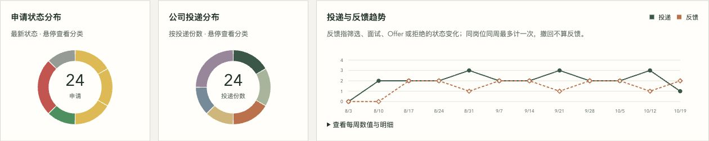

# Scientific Interview

English | [简体中文](README.zh-CN.md)

Use AI to find jobs, refine your resume, and review interviews. Keep job sources, application progress, and personal records in a local HTML dashboard.

An open-source **Skill + local toolkit**: your AI host handles conversation and analysis, while the scripts validate and save records. **v0.14.0** is available for trial use from the complete source tree. Seventeen international sources are now available experimentally, including LinkedIn, Indeed, OpenAI, Google and Amazon (see search scopes below). Existing job sites include Tencent, Meituan, Amap, ByteDance, JD, DiDi, Xiaohongshu, Kuaishou, and the Kimi, Zhipu, and StepFun tenants on Moka. Browser access supports **Tabbit's official CLI** and **Codex's Chrome extension** as separate slots; you handle login and verification challenges. See the [Tabbit setup and validation guide](skills/scientific-interview/references/tabbit.md).



*The screenshot uses synthetic statistics. The starter demo contains a small set of jobs to illustrate the workflow.*

## What it does

- **Incremental job search**: save search criteria and compare newly discovered jobs, JD changes, and closures supported by evidence. Preserve sources, snapshots, and verification timestamps.
- **Resume creation and revision**: import an existing PDF resume or build one through an experience interview. Ask up to three questions per round, confirm facts, save versions, and export Word, PDF, and Markdown. Imported originals are available to open from the private resume tab.
- **Interview debriefs**: recount an interview to the AI and record questions, answers, strengths, gaps, and supporting evidence. Reviewed debriefs can inform resume revisions and job matching.
- **Job matching**: display 1–5 scores, matching reasons, and gaps; sort jobs by fit. Existing assessments can be imported directly without an extra score badge, and newer reviews take precedence.
- **Job selection and tracking**: mark jobs you have not applied to as shortlisted or not interested. The default undecided state is available as a filter without a visible badge. Tag clicks update the list immediately while saves run in order; failed saves roll back unconfirmed choices and ask you to refresh. Track submitted applications by their latest status, preserving ended processes, talent-pool transfers, and closed positions as distinct categories.
- **Job search statistics**: an application overview, status rings, application and feedback line charts, company distribution, and role/industry breakdowns with independently scrollable charts. Industry labels are based on documented company or business-unit activities. Jobs become inactive after 30 days without a substantive change, or can be marked inactive by the user with a recorded reason; application statuses are preserved. Inactive unfinished applications leave the in-progress count and appear in a separate ring segment.
- **Extensible slots**: add website and browser adapters independently through defined protocols, capability declarations, and access checks.

Semantic analysis happens in your AI host; the HTML dashboard displays your local records. No additional model API key is required by this project, but model access depends on your host account. There is no built-in scheduled search service. Submitting an application requires user authorization and verification of the result.

The README and HTML dashboard support English and Simplified Chinese. The dashboard defaults to English; use the language selector in the header to switch. Your choice is saved in this browser when local storage is available. Filters stay in place when switching. Job descriptions, company names, classifications, resumes, and interview records retain their original language. Most detailed workflow documents use Chinese.

## Install and try it

### 1. Get the complete source

Download and extract **Code → Download ZIP** from the [GitHub repository](https://github.com/ft1148137/scientific-interview), or clone it:

```bash
git clone https://github.com/ft1148137/scientific-interview.git
cd scientific-interview
```

Open a terminal in the project directory and confirm that it contains `pyproject.toml`, `skills/`, and `job_workbench/`.

You need **Python 3.10+**. Live job collection requires either Tabbit with its official `tabbit-cli` launcher, or a Codex environment with Chrome extension access. The demo, manual JD import, and dashboard work without the browser extension. Node.js 18+ is only needed for slot examples and development tests.

Install from the complete source tree. Copying only `SKILL.md` is insufficient; a similarly named PyPI package is not an installation source for this project. The commands below have been verified in an isolated macOS environment. Windows has not completed full validation.

### 2. Create an environment and install

On macOS / Linux, run from the project root:

```bash
python3 -m venv data/dev/venv
. data/dev/venv/bin/activate
python -m pip install -e ".[resume]"
python -m job_workbench doctor
```

Equivalent environment setup in Windows PowerShell:

```powershell
py -3 -m venv data/dev/venv
.\data\dev\venv\Scripts\Activate.ps1
python -m pip install -e ".[resume]"
python -m job_workbench doctor
```

`[resume]` installs Word/PDF dependencies. For the core tools and HTML only, use `python -m pip install -e .`; the core uses Python's standard library. `doctor` checks source resources, dependencies, and slot declarations, and shows the current and suggested Python paths. Passing this check does not mean a browser is connected.

### 3. Enable the Skill

```bash
python scripts/install_skill.py
```

The installer checks the complete source resources, then creates a `scientific-interview` symlink in Codex's skills directory pointing to this checkout. The default destination is `~/.codex/skills/`, or the `skills/` subdirectory of `CODEX_HOME` when set. Existing files and other links are not overwritten.

Check the installation without changing it:

```bash
python scripts/install_skill.py --check
```

After moving the project, recreate its virtual environment and install dependencies at the new location, then run `python scripts/install_skill.py --repair` to repair the old symlink. Repair refuses to replace regular files or directories and preserves the original link if it fails. See the [migration guide](docs/migration.md).

Start a new Codex conversation and invoke **`$scientific-interview`**. Keep the source directory and virtual environment, and have Codex use the Python environment you created. If dependencies cannot be found, tell it: “Use the Python interpreter in this project's `data/dev/venv`.”

You can also use the Skill without installing a link: open this project in Codex and ask it to “Read and use `skills/scientific-interview/SKILL.md`.” This also works when Windows does not permit symlink creation. Use the selected browser’s documented host: Tabbit CLI for `tabbit`, or Codex Chrome tools for `codex-chrome`; see the [browser collection guide](skills/scientific-interview/references/browser.md).

### 4. Connect a browser for live collection

Skip this step for the demo or manual JD import. Choose a browser explicitly; continuing a task keeps the browser you already selected, and connection failures do not switch it automatically.

| Browser slot | Setup | Verified scope |
|---|---|---|
| `tabbit` | Install [Tabbit](https://www.tabbit.com/), finish its setup, then use its official CLI and bundled Skill. No Codex Chrome extension is needed. | macOS, Tabbit 1.16.27: Tencent, Kimi (Moka), ByteDance campus and DiDi; Tencent/Kimi pagination and resumption; 1.18.21: 17 international sources, with limits below |
| `codex-chrome` | Connect the Chrome extension in a supported Codex host. | Existing site checks plus samples from 17 international sources; signed-in LinkedIn passed US scope, two pages and resumption. See the [support record](docs/site-support.md#overseas-chrome); results do not automatically carry over to Tabbit |

On macOS, check that Tabbit's stable launcher is available:

```bash
"$HOME/.local/bin/tabbit-cli" diagnose
```

If the launcher or bundled Skill is missing, follow the [Tabbit setup guide](skills/scientific-interview/references/tabbit.md). Importing Chrome passwords or login data is optional. Login and CAPTCHA challenges remain manual. Browser profiles and host-managed runtime files stay in the browser's own directories; this project's scans, checkpoints and saved screenshots go under `data/`.

The Tabbit sample collected seven complete JDs into an isolated archive. JD experienced hiring needs login; JD campus search can leave the unfiltered list visible, so the adapter waits for changed results and returns a retry instead of collecting that list. Windows and login-handoff recovery have not been verified. See the [full validation record](docs/site-support.md).

### 5. Open the synthetic demo

```bash
python -m job_workbench --data data/demo demo
python -m job_workbench --data data/demo serve --port 8877
```

Open the [local demo dashboard](http://127.0.0.1:8877/index.html). Keep the terminal running; press `Ctrl+C` to stop the server. The demo includes two scans, JD changes, a shortlist, applications, a resume, and an interview debrief. All people and experiences are synthetic. Running it again preserves existing demo records.

You can also open `data/demo/report/index.html` as a static snapshot. Saving labels and live debrief synchronization require access through `serve`.

## Start your own job search archive

Stop the demo server, then create a separate private archive:

```bash
python -m job_workbench init
python -m job_workbench render
python -m job_workbench serve --port 8877
```

The default archive is `data/main/`; it does not reuse demo records. Example prompts for Codex:

> Use $scientific-interview with data/main and the tabbit browser slot. Find AI application engineering jobs on Tencent's careers site. Hand over to me if login is required.

> Revise my resume for data analysis roles. Check the facts first, then ask questions that help me recall relevant experience. Do not invent achievements.

> I just completed an interview. Here is my recollection. Organize the questions, answers, strengths, and gaps. After I review them, save the debrief for future resume revisions and job matching.

> Run my last search again. Show newly discovered jobs, JD changes, and items needing verification, then update the dashboard.

Personal experiences and common answers remain available as supporting records. The former experience-gap planning board has been removed. Interview recollections and analysis are saved separately; unreviewed content is not treated as confirmed fact. See the [debrief workflow](skills/scientific-interview/references/debrief.md) and [resume workflow](skills/scientific-interview/references/resume.md).

## Data, privacy, and sharing

**All business data and runtime artifacts are stored under this project's `data/` directory, which Git ignores entirely.**

| Location | Purpose |
|---|---|
| `data/main/` | Default private archive: jobs, debriefs, experiences, resume versions, original-file copies, backups, and exports |
| `data/main/report/index.html` | Complete private dashboard |
| `data/demo/` | Synthetic demo archive |
| `data/dev/`, `data/tmp/` | Local environments, development artifacts, and test output |
| `examples/`, `docs/assets/` | Synthetic fixtures and illustrations distributed with the source |

Use `--data data/another-archive` or `SCIENTIFIC_INTERVIEW_DATA` to choose an archive. Relative data and output paths resolve from the project root. Writes outside `data/` are rejected; external resumes may be imported read-only. When moving the project, preserve the entire `data/` directory, recreate the virtual environment, and repair the Skill link. See [migration](docs/migration.md).

Local storage does not mean offline AI: content given to your host for analysis is subject to that host's data policies. The archive has no additional encryption. The complete HTML dashboard, `resume.json`, and `changes.md` may contain private information.

To share only the job list:

```bash
python -m job_workbench render --share
```

Inspect and share only the generated `data/main/share/index.html`. This copy excludes personal records, debriefs, matching reviews, decisions, resumes, applications, and history. You still need to check whether job text and source links are suitable for public sharing.

## Common commands

```bash
python -m job_workbench --help
python -m job_workbench status
python -m job_workbench interview first --target 'AI Application Engineer'
python -m job_workbench render
```

Save the original JD text to `data/main/inbox/jd.txt`, then import it manually:

```bash
python -m job_workbench add-jd data/main/inbox/jd.txt --title 'Engineer' --company 'Target Company' --url 'https://example.com/jobs/1' --complete
```

Use `--complete` only when the original JD is complete; it does not prove the job is still open. See the [resume guide](skills/scientific-interview/references/resume.md) for import, revision, and export commands, and [statistics definitions](docs/statistics.md) for counting rules. After installation, the `scientific-interview` command is also available. The `job_workbench` module, legacy command, and `JOB_WORKBENCH_*` environment variables remain compatible; new environment variables take precedence.

## Supported websites

These are registered website adapters. Earlier site validation used Codex Chrome; Tabbit has only the scope listed above. A capability check is not a live test of every browser/site pair.

For existing local archives, follow the [migration guide](docs/migration.md). Historical imports retain their observation dates and remain unverified. Missing source URLs stay empty with a stable record ID; receipt without a submission date counts as an application without inventing a date for the trend chart.

| Website | Slot ID | Current entry point |
|---|---|---|
| Tencent | `tencent` | Existing careers site adapter |
| Meituan | `meituan` | General list including experienced, graduate and internship roles; no campus-only slot yet |
| Amap | `amap` | Experienced hiring |
| ByteDance | `bytedance` | Experienced hiring |
| Tencent campus | `tencent-campus` | Graduate project; keyword, JD, pagination and checkpoint resumption |
| JD campus | `jd-campus` | Chrome keyword/JD/resumption checks exist; pagination remains limited. Tabbit initial search is unstable and may return RETRY. |
| DiDi campus | `didi-campus` | Separate Moka campus tenant; keyword, JD and checkpoint resumption; paging encountered a load timeout |
| Kuaishou campus | `kuaishou-campus` | Current 2027 graduate project; keyword, JD, pagination and checkpoint resumption |
| ByteDance campus | `bytedance-campus` | Campus portal; graduate and internship roles, with original project labels |
| JD | `jd` | Experienced hiring; details expand within the list |
| DiDi | `didi` | Experienced hiring |
| Xiaohongshu | `xiaohongshu` | Experienced hiring |
| Xiaohongshu campus | `xiaohongshu-campus` | Current graduate recruitment list; separate internship/REDstar portals excluded |
| Kuaishou | `kuaishou` | Domestic experienced hiring |
| Kimi (Moonshot AI) | `moka-kimi` | Moka experienced-hiring tenant |
| Zhipu | `moka-zhipu` | Moka experienced-hiring tenant |
| StepFun | `moka-step` | Moka experienced-hiring tenant |
| Kimi campus / internships | `moka-kimi-campus` | Independent tenant; keyword, JD, second-page and checkpoint verification |
| Zhipu campus / internships | `moka-zhipu-campus` | Independent tenant; keyword, JD and checkpoints; current catalog fits on one page |
| StepFun campus / internships | `moka-step-campus` | Independent tenant; keyword, JD, second-page and checkpoint verification; separate StepStar tenant excluded |

For example: “Use Scientific Interview to search Meituan, ByteDance, and Kimi for my target roles. Read a batch of JDs and save them to my current archive.” The added slots support keyword search; city and role criteria are checked after collection. For campus hiring, explicitly choose `bytedance-campus`, `xiaohongshu-campus`, `tencent-campus`, `jd-campus`, `didi-campus`, `kuaishou-campus`, `moka-kimi-campus`, `moka-zhipu-campus`, or `moka-step-campus`. These have separate source identities and domain/path checks; graduation eligibility and internship requirements must be checked against the saved JD. Unlisted campus channels are not yet supported. JD and DiDi campus pagination has live-test limitations described in the support matrix. Kuaishou uses the current graduate project; its next annual project requires verification. Moka uses a shared parser, but each employer needs an independent tenant declaration; the adapter does not scan the entire platform.

The three new Moka campus slots were checked on 2026-10-23 with 9 sample JDs and duplicate-import verification: 6 passed completeness checks; 3 custom-format JDs remain pending review. Original job type and function are retained. Location comes from the explicitly labelled detail field; a missing location stays unknown. These portals mix graduate and internship roles, and a campus URL alone does not establish graduation eligibility. No samples were imported into the main archive.

Try: “Search Kimi, Zhipu, and StepFun campus roles for Agent. Use the three `moka-*-campus` slots, retain internship and graduation requirements, and save a small batch to my archive.”


### International sources (experimental)

The 17 sources introduced in v0.13.0 were sampled through **Tabbit 1.18.21 on macOS** on 2026-10-26. Each produced two job records; this is bounded verification, not full-catalog coverage. The existing 20 sources remain registered.

| Search mode | Sources / slot IDs | Scope |
|---|---|---|
| Native keyword search | LinkedIn (`linkedin`), Indeed (`indeed`), Anthropic (`anthropic`), Google (`google`), Microsoft (`microsoft`), Amazon (`amazon`), NVIDIA (`nvidia`), Apple (`apple`), Stripe (`stripe`), Airbnb (`airbnb`), Uber (`uber`), Netflix (`netflix`), Meta (`meta`) | Indeed uses the US site; Apple defaults to US locations. These accept `keyword`; LinkedIn also accepts `city` as country, region or city text. |
| Filter rendered titles | OpenAI (`openai`), Databricks (`databricks`), YC Work at a Startup (`yc`), Wellfound (`wellfound`) | Case-insensitive title tokens on the loaded list. Wellfound currently uses only its **Software Engineer** category; these are not global full-text searches. |

LinkedIn defaults can be saved locally as `linkedin-default`: `Engineer`, a user-supplied country/region/city, no additional filters. On first use, the Skill asks for keywords and a country/region/city (optionally a career direction), with an explicit region required; later runs reuse the saved version. See the [template](examples/linkedin-search.json) and [setup workflow](skills/scientific-interview/references/international.md#linkedin-默认条件与首次使用). The signed-in layout selects visible location suggestions and verifies the applied region. Chrome checks passed US search, details, two pages and resumption. This layout has no verified global option; ambiguous locations require a full suggestion label.

Google, Amazon, Anthropic and Microsoft passed second-page checks; Amazon also passed checkpoint resumption. Other pagination limits, incomplete descriptions, and entry URLs are documented in the [support matrix](docs/site-support.md#overseas). No full catalog is claimed. Codex Chrome checks now include list/detail samples from all 17 sources, including the later signed-in LinkedIn fix. Five sources needed a loading retry; Google pagination passed on a second attempt. See the [Chrome validation record](docs/site-support.md#overseas-chrome). Country, remote eligibility, visa sponsorship and graduation requirements must be checked in the original JD; missing information stays unknown. Listings can include internships, but this release does not add dedicated international campus channels or application-status synchronization.

Example: “Use Scientific Interview with Tabbit to search `google`, `amazon` and `openai` for Machine Learning Engineer. Save a small batch, preserve location and eligibility evidence, and report search coverage.” Follow the existing Tabbit guide, replacing the imported site ID. Collection never follows an external application link automatically.

BOSS Zhipin and Liepin are under integration testing and are not registered sources yet. Logged-in page access remained unstable on 2026-10-23; search, pagination, and checkpoint scans have not passed live verification.

Baidu's recruitment page became blank during both integration attempts on 2026-10-22, so it is not registered as supported. Meituan has a campus list, but shares detail URLs with the general portal; a dedicated campus slot still needs job-type validation at collection and import. Automotive, manufacturing, and other non-internet employers remain deferred. JD jobs can share a list URL and are distinguished by job ID; opening a source link requires locating the job by title. Live verification used small samples, not exhaustive scans. See [support and verification records](docs/site-support.md).

## Troubleshooting

| Issue | What to do |
|---|---|
| Missing dependency or module | Activate the project's virtual environment, reinstall, and run `doctor`. The AI must use the same Python environment. |
| Skill does not appear | Start a new Codex conversation, or ask it to read the project's `SKILL.md` directly. |
| Installer says the destination exists | Regular files and directories are never overwritten. Use `--repair` after confirming that an old symlink should point to this checkout. |
| Browser disconnected or login required | Follow the selected browser guide to connect Tabbit/Chrome or log in yourself. Keep the checkpoint; the workflow will not switch to a crawler. |
| Port already in use | Use `serve --port 8878` and change the browser URL's port too. |
| Labels cannot be saved | Access the page through `serve`. Opening HTML directly gives a read-only snapshot. |
| Scanned PDF has no extractable text | OCR is not included. Provide a text-extractable PDF or describe your experience; resume-file import accepts PDF only. |
| Updating the source | Preserve `data/`, update the source, then repeat the editable install and `doctor`. Do not overwrite private records with a fresh checkout. |

## Extend and develop

```text
skills/scientific-interview/   Skill and on-demand workflow references
contracts/                    Protocol, data formats, and access checks
slots/sites/                  Website adapters, Moka tenants, shared parsers
slots/browsers/               codex-chrome, tabbit
job_workbench/                Validation, versioned records, resumes, local server
templates/                    HTML dashboard
examples/                     Public synthetic fixtures
tests/                        Python behavior tests and JS contract tests
data/                         Local data and generated artifacts; never commit
```

Implement SiteSlot for a website or BrowserPort for a browser, register its manifest, and pass capability, domain, and page checks. See [architecture](docs/architecture.md), the [protocol](contracts/protocol.md), and the [contribution guide](docs/contributing.md). For an example without browser dependencies, run `node examples/slot-extension.mjs`.

After installing all dependencies, run:

```bash
python -m unittest discover -s tests -v
node --test tests/*.test.mjs
python scripts/check_project.py
python scripts/package_source.py
```

The last command must run inside this project's Git repository; ZIP users can run `git init` first. It checks release candidates for common personal paths and secret patterns, then writes a source archive and checksum manifest to `data/releases/`. It excludes private data and development environments, but new fixtures and screenshots still require review. It does not replace a privacy audit. Do not publish a ZIP of the entire local working directory.

See the [release-readiness record](docs/release-readiness.md) for completed checks and the [website support list](docs/site-support.md) for entry points, search scopes, and live verification limits. Codex Chrome and Tabbit are registered browser slots. Tabbit 1.16.27 and 1.18.21 were sampled on macOS; see the browser guide for verified sites and limits. Other websites, Windows, complex multi-page resumes, and trials with three new real users have not completed full acceptance testing.

Source code is licensed under [MIT](LICENSE). The bundled Noto Sans SC font uses [SIL OFL](assets/fonts/OFL.txt); see its [source notes](assets/fonts/README.md). This project's license does not grant rights to third-party website content, brands, or runtime environments.
